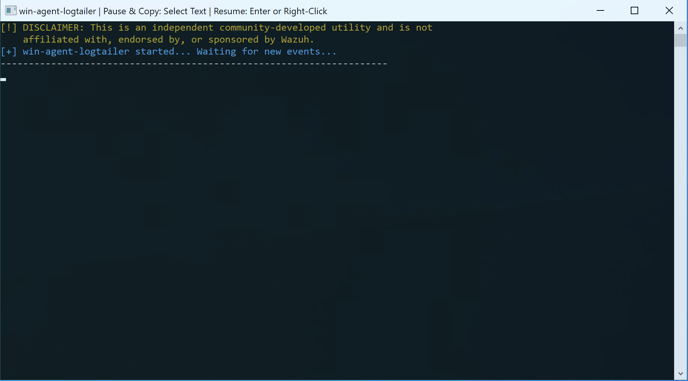
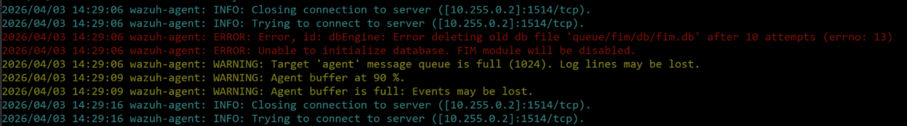

# win-agent-toolbox

> **LEGAL DISCLAIMER:**  
> This repository contains independent community-developed utilities and is not affiliated with, endorsed by, or sponsored by Wazuh. The tools are described as compatible with Wazuh agent logs where applicable and are not official Wazuh products.  
> "Wazuh" is a trademark of Wazuh, Inc. The name is used solely to describe compatibility with Wazuh-related components and log files.

## Description

`win-agent-toolbox` is a Windows-focused collection of lightweight utilities for operational troubleshooting, debugging, and day-to-day support tasks around Wazuh agent environments. The repository is designed as a toolbox and will be extended over time with additional small utilities for Windows-based agent operations.

The first included utility is `win-agent-logtailer`, a Go-based command-line tool that monitors the local `ossec.log` file in real time. It acts as a native Windows equivalent to the Linux `tail -f` command and is intended for troubleshooting and monitoring Wazuh agent activity.




## Current tools

### win-agent-logtailer

`win-agent-logtailer` is a lightweight, Go-based command-line utility for monitoring local agent logs (`ossec.log`) in real time on Windows systems.

#### Features

- **Real-time monitoring:** Continuously reads new entries appended to the `ossec.log` file.
- **Color-coded output:** Automatically parses log severity and applies ANSI color highlighting for better readability:
    - `CRITICAL`: Alarm red
    - `ERROR`: Red
    - `WARNING`: Orange
    - `INFO`: Cyan
    - `DEBUG`: Gray
- **Native Windows support:** Enables ANSI color rendering in standard Windows consoles such as `cmd.exe` and PowerShell.
- **Zero dependencies:** Distributed as a standalone, statically compiled `.exe` binary.

## Prerequisites

- Windows Operating System (Windows Server / Windows 10 / Windows 11)
- Installed Wazuh Agent (default path: `C:\Program Files (x86)\ossec-agent\`)
- **Execution Rights:** Administrative privileges may be required to access `ossec.log`, depending on the local file permissions.
- **Downloaded File Handling:** Windows may mark the downloaded executable as blocked or display a Microsoft Defender SmartScreen warning before first execution.

## Usage

1. Download the compiled `win-agent-logtailer.exe`.
2. Verify the published checksum before executing the file.
3. If Windows marks the file as blocked, right-click the file, open **Properties**, and enable **Unblock** on the **General** tab.
4. If access to `ossec.log` is denied, start the tool from an elevated Command Prompt or elevated PowerShell session.
5. Execute the binary:

   ```cmd
   .\win-agent-logtailer.exe
   ```

### UI controls

- **Pause output:** Select text inside the console window.
- **Resume output:** Press `Enter` or right-click inside the console window.
- **Exit:** Press `Ctrl + C`.

## Download integrity

Use the following checksums to verify the published `win-agent-logtailer.exe` binary:

### SHA256

```text
dbb2f3ec91e6560efcc7b865e94709e1fe26c12f89773b96960f9b99b589c8a0  win-agent-logtailer.exe
```

### SHA512

```text
b51565874ea420c030b657cf2dd6b1b88f70a230636819adf930da661eff0bb159490ef00e83351ae68a9953f8e77b85fec6ee7d28b60f3f4a68f30f06a11683  win-agent-logtailer.exe
```

### Verification examples

#### Linux / macOS

```bash
sha256sum win-agent-logtailer.exe
sha512sum win-agent-logtailer.exe
```

#### Windows PowerShell

```powershell
Get-FileHash .\win-agent-logtailer.exe -Algorithm SHA256
Get-FileHash .\win-agent-logtailer.exe -Algorithm SHA512
```

## Windows execution notes

- **Administrative privileges may be required:** If the process cannot access `C:\Program Files (x86)\ossec-agent\ossec.log`, start the tool from an elevated shell.
- **Unblock downloaded binaries if required:** On some systems, Windows attaches a download origin marker to internet-downloaded files. If the executable is blocked, open the file properties and enable **Unblock** before starting it.
- **Microsoft Defender SmartScreen:** Because this is an independently distributed utility, Windows may display a warning for an unrecognized app. Verify the published checksum from the official download page before deciding whether to run it.

## Repository structure

This repository is intended to grow over time. The current layout is structured so that additional tools can be added cleanly.

```text
win-agent-toolbox/
├── bin/
├── cmd/
│   └── win-agent-logtailer/
│       └── main.go
├── LICENSE.md
├── README.md
└── go.mod
```

Future tools can be added under `cmd/` as separate self-contained utilities.

## Building from source

If you prefer to compile the binary yourself, ensure that Go is installed.

1. Clone the repository.
2. Open a terminal in the project root.
3. Run:

   ```cmd
   GOOS=windows GOARCH=amd64 go build -ldflags="-s -w" -o bin/win-agent-logtailer.exe ./cmd/win-agent-logtailer
   ```

## License and copyright

**Copyright (c) 2026 Stephan H. Wenderlich**  
**Gray-Hat IT-Security Consulting Stephan H. Wenderlich**  
**Web:** [https://gray-hat-it-security-consulting.de](https://gray-hat-it-security-consulting.de)

This project is licensed under a Custom License. See the [LICENSE.md](LICENSE.md) file for the full terms and conditions.

- This software is provided "AS IS" without warranty of any kind.
- Commercial use is restricted as defined in the license terms.
- Redistribution requires attribution and retention of the license text.
