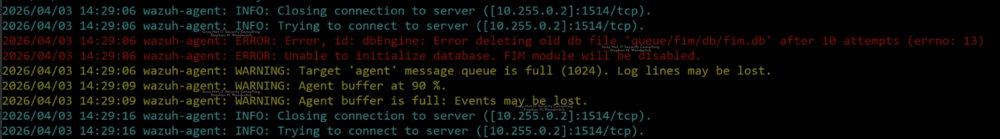
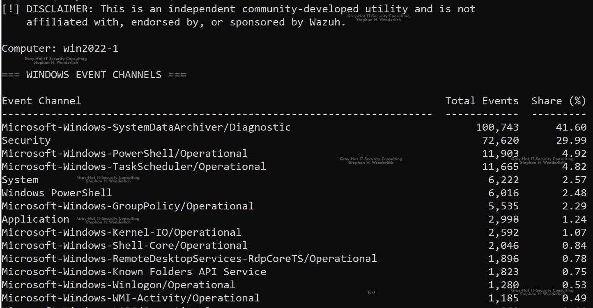
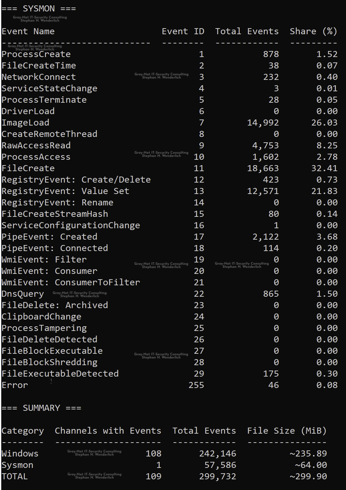

# win-agent-toolbox

> **LEGAL DISCLAIMER:**
> This repository contains independent community-developed utilities and is not affiliated with, endorsed by, or sponsored by Wazuh. These utilities are not official Wazuh products.
> "Wazuh" is a trademark of Wazuh Inc. The name is used solely to describe compatibility with Wazuh-related components and log files.

## Description

`win-agent-toolbox` is a collection of small Windows utilities written in Go. Each tool provides a compiled binary for a specific task, avoiding the need to distribute and maintain editable scripts.

- `win-agent-logtailer` monitors the local Wazuh agent `ossec.log` file in real time.
- `win-eventstats` counts locally stored Windows events and reports their log file sizes, with a separate breakdown for Sysmon.

## Current tools

### win-agent-logtailer

`win-agent-logtailer` monitors the local Wazuh agent log (`ossec.log`) in real time. It acts as a native Windows equivalent to the Linux `tail -f` command and is particularly useful when the agent's debug mode is enabled.




#### Features

- **Real-time monitoring:** Continuously reads new entries appended to the `ossec.log` file.
- **Color-coded output:** Automatically parses log severity and applies ANSI color highlighting for better readability:
    - `CRITICAL`: Alarm red
    - `ERROR`: Red
    - `WARNING`: Orange
    - `INFO`: Cyan
    - `DEBUG`: Gray
- **Native Windows support:** Enables ANSI color rendering in standard Windows consoles such as `cmd.exe` and PowerShell.
- **Zero dependencies:** Distributed as a standalone, statically compiled `.exe` binary.

### win-eventstats

`win-eventstats` counts events per Windows event channel and reports log file sizes. Sysmon event counts are broken down by event ID. These figures can support Wazuh SIEM storage planning.




#### Features

- **Windows event channels:** Lists channels with recorded events, excluding Sysmon, sorted by total event count in descending order.
- **Channel share:** Shows each channel's percentage of all counted Windows events, excluding Sysmon.
- **Sysmon breakdown:** Lists event names, event IDs, total events, and each ID's percentage of counted Sysmon events.
- **Summary:** Shows Windows, Sysmon, and TOTAL figures for channels with events, total events, and approximate log file sizes in MiB.

## Prerequisites

- Windows Operating System. Tested on Windows Server 2016 and 2022.
- Administrative privileges for both tools.

## Usage

1. Read the README and the source code, and understand what the tools do before running them.
2. Download the compiled executable for the required tool and verify its published checksum.
3. Both executables may need to be unblocked: right-click each downloaded file, open **Properties**, and enable **Unblock** on the **General** tab if present.
4. Start Command Prompt (`cmd.exe`) as administrator. This is the recommended way to run both tools.
5. Change to the directory containing the executable and run the required tool.

### win-agent-logtailer

```cmd
.\win-agent-logtailer.exe
```

#### UI controls

- **Pause output:** Select text inside the console window.
- **Resume output:** Press `Enter` or right-click inside the console window.
- **Exit:** Press `Ctrl + C`.

---

### win-eventstats

```cmd
.\win-eventstats.exe
```

To save the report:

```cmd
.\win-eventstats.exe > report.txt
```

Press `Ctrl + C` to cancel a running scan.

## Download integrity

Use the following checksums to verify the published binaries.

### SHA256

```text
cbce8bcdde4abc0c3c9208d7542c14e63e6777f7286af85ae581b3e8ee33cf91  win-agent-logtailer.exe
9055d789204a48c0a024ac6190c42c7b2acb3eb7c52af41838a55a5f3e7d658e  win-eventstats.exe
```

### SHA512

```text
61301a40677c870d8aeeee4ad51fa4c5b180bdb9d06b3c03deb9f7c26d52aea2bc103f88f198d90d42db3d000244b5832d4984806653263c9a93fd51b2c159f3  win-agent-logtailer.exe
781b3aab5c6a989a1dcc983b1ce57b8b92b0a6d81f0eb6432b664c07f6178c3ed8ee77b924c8f35f59fb852c6848526e853cf1a242e195b9011d9f08e1116720  win-eventstats.exe
```

### Verification examples

#### Bash with sha256sum / sha512sum

Run in the directory containing the downloaded binaries:

```bash
sha256sum win-agent-logtailer.exe win-eventstats.exe
sha512sum win-agent-logtailer.exe win-eventstats.exe
```

#### Windows PowerShell

```powershell
Get-FileHash .\win-agent-logtailer.exe -Algorithm SHA256
Get-FileHash .\win-agent-logtailer.exe -Algorithm SHA512
Get-FileHash .\win-eventstats.exe      -Algorithm SHA256
Get-FileHash .\win-eventstats.exe      -Algorithm SHA512
```

## Repository structure

```text
win-agent-toolbox/
├── bin/
├── cmd/
│   ├── win-agent-logtailer/
│   │   └── main.go
│   └── win-eventstats/
│       └── main.go
├── images/
├── LICENSE.md
├── README.md
└── go.mod
```

## Building from source

With Go installed, clone the repository and open Bash in the project root.

### win-agent-logtailer

```bash
GOOS=windows GOARCH=amd64 CGO_ENABLED=0 go build -ldflags="-s -w" -o bin/win-agent-logtailer.exe ./cmd/win-agent-logtailer
```

### win-eventstats

```bash
GOOS=windows GOARCH=amd64 CGO_ENABLED=0 go build -trimpath -ldflags="-s -w" -o bin/win-eventstats.exe ./cmd/win-eventstats
```

Both commands produce Windows AMD64 executables in `bin/`.

## License and copyright

**Copyright (c) 2026 Stephan H. Wenderlich**
**Gray-Hat IT-Security Consulting Stephan H. Wenderlich**
**Web:** [https://gray-hat-it-security-consulting.de](https://gray-hat-it-security-consulting.de)

This project is licensed under a Custom License. See the [LICENSE.md](LICENSE.md) file for the full terms and conditions.

- This software is provided "AS IS" without warranty of any kind.
- Commercial use is restricted as defined in the license terms.
- Redistribution requires attribution and retention of the license text.
